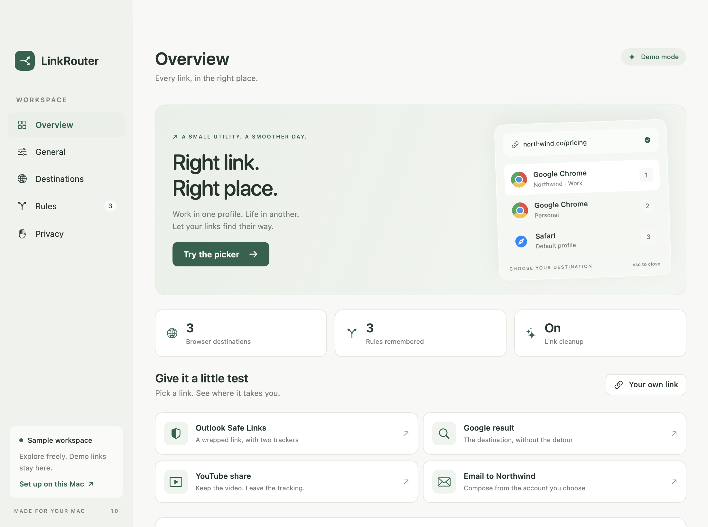

# LinkRouter for macOS

A native SwiftUI + AppKit menu-bar utility that cleans incoming links and hands them to the browser, profile, or email account you choose. Requires macOS 14 or later and Swift 6 or later. No third-party dependencies.



## Download the developer preview

The downloadable build is for **Apple Silicon Macs running macOS 14 or later**. [Download the beta ZIP](https://github.com/himanpatidar/LinkRouter/raw/refs/heads/main/downloads/LinkRouter-macOS-arm64.zip), read the [release notes](docs/RELEASE-NOTES.md), and check its [SHA-256 checksum](downloads/SHA256SUMS). Intel users can try building from source on their own Mac; an Intel release has not been tested.

This preview is **ad-hoc signed and not notarized by Apple**. It is intended for early testers. Download it only from this repository's `downloads` folder and review the source if you wish. On supported personal Macs, macOS may offer a per-app exception under **System Settings → Privacy & Security → Open Anyway** after a blocked launch. Follow [Apple's explanation](https://support.apple.com/en-us/102445) and decide whether you trust the app. Managed Macs may not permit installation. Do not disable Gatekeeper or other system protections globally.

1. Download and unzip `LinkRouter-macOS-arm64.zip`.
2. Move `LinkRouter.app` to `/Applications`, then open it.
3. Explore the sample workspace or choose **Set up on this Mac**.
4. Discover your browser profiles and choose the default web handler only when you are ready to try real links.

The first launch does not automatically change your default apps. LinkRouter stays in the menu bar when you close its settings window. To stop using it, select another default browser in macOS System Settings, change your default email reader if you enabled email routing, and quit LinkRouter from its menu-bar menu.

Please report problems through GitHub Issues using the [testing guide](docs/BETA-TESTING.md). Avoid posting private URLs, account addresses, credentials, or company browser-profile data.

## Build and open

```sh
zsh scripts/build-app.sh
open build/LinkRouter.app --args --demo
```

The build script creates an ad-hoc-signed app bundle, including its icon and URL-handler registration. Full Xcode is optional; the macOS Command Line Tools are sufficient. Use `zsh scripts/build-app.sh debug` for a faster development build. Open `Package.swift` in Xcode if you prefer its debugger.

The script includes a project-local workaround for CLT installations with mismatched public/private `PackageDescription` interfaces. It does not change the installed toolchain. On a consistent toolchain, ordinary `swift build` and `swift test` work directly.

## Try it

The first launch opens a sample workspace with Northwind and Personal profiles, two Gmail accounts, and editable sample rules. Sample links, copies, account changes, and rules are simulated in memory: no browser opens and the clipboard stays unchanged. Click **Try the picker**, then press **1–5**, **↑/↓** and **Return**, **C** to copy, or **Escape** to cancel. Hold **⌘** while choosing, or check **Remember**, to create a rule explicitly. Use **Link details** to inspect the original and final URL.

Choose **Set up on this Mac** to run the five-step onboarding. It lets you request the default web/mail handlers, discover actual browsers, choose a fallback, and open a real test link. You can skip changing the defaults. The app never changes the system handler automatically. Once set up, close the window and use the menu-bar icon to reopen it, route a clipboard link, or quit.

For everyday use, move the app to `/Applications` before selecting it as default or enabling launch at login. The preview can be shared without Apple Developer membership, but it will not have the normal trust afforded by Developer ID signing and notarization. A future notarized release requires that signing identity and Apple's notarization service.

## What is implemented

- System `http`, `https`, and `mailto` Apple-event handling, including multiple incoming requests.
- A floating picker clamped to the cursor's screen, with keyboard shortcuts, explicit remember scopes, and URL diagnostics.
- Browser discovery: Chrome, Brave, Edge, Chromium profiles; Safari, Firefox, Arc, and Zen as whole-app destinations when installed. Safari and Firefox profile selection is not implemented.
- Chrome account hints from `Local State` / profile `Preferences`; manual Gmail-account-to-profile mapping; Apple Mail, Outlook, and Spark when installed.
- Browser launching via explicit application IDs. Chromium uses its executable with `--profile-directory` to select an existing profile, including when the browser is already running. Missing profiles fail back to the picker instead of creating a new profile.
- Gmail compose with an email-valued `authuser`, plus recipients, cc, bcc, subject, and body. Gmail controls sign-in and the final sender. Local files cannot prove that an account is currently signed in. Unconfirmed accounts require a confirmation before compose opens; users can mark an account as checked in Destinations. LinkRouter never sends email.
- Rules with search, creation, editing, enable/disable, reordering, and deletion. Exact domains precede website wildcards, then event-sender app rules, then separate web/mail defaults. Wildcards match subdomains only. Unavailable or incompatible destinations are skipped. Multi-domain email messages skip recipient-domain rules. Option forces the picker when the modifier is present at URL delivery.
- SQLite persistence for rules, preferences, and manually added accounts. No URL history is persisted. Demo settings remain in memory. SQLite files are owner-readable/writable only.
- Default-handler requests through NSWorkspace and launch at login through SMAppService. macOS may ask for confirmation or require approval in Login Items; errors are surfaced.

## Cleanup policy

Only recognized hosts and paths are unwrapped: Outlook Safe Links, selected Google `/url` regional hosts, Slack's `slack-redir.net/link`, and transparent Buttondown `/redirect?url=` links. Targets must be absolute HTTP(S) URLs without credentials. Unwrapping is bounded to five layers and detects repeated destinations. Unknown/opaque newsletter links are preserved, not fetched. Google hosts can be expanded in the allowlist as needed.

Known analytics parameters (`utm_*`, click IDs, `mc_cid`, `mc_eid`, HubSpot IDs, and YouTube share `si`) are removed without rewriting other query bytes or fragments. Broad `mc_*` deletion is intentionally avoided because unknown fields can be meaningful. Common signature markers protect signed URLs from query cleanup. This is a conservative allowlist, not a guarantee for every signing convention. Mailto URLs are excluded from web cleanup entirely.

Source-app context uses the OS-supplied sender PID of a URL Apple event. It is never inferred from the frontmost app. Some apps supply no sender; intermediary services may identify themselves rather than the original app. Website and recipient rules work independently of sender metadata.

## Preview limitations

- **Option-click is not dependable in every app.** In a Slack test, the link reached LinkRouter but Option-click did not force the picker. Use **Ask every time** in General for reliable picker testing, or use the menu-bar **Route clipboard link** command to force a single picker.
- **Gmail accounts are candidates, not verified sessions.** Always check the sender in Gmail. LinkRouter cannot guarantee the active account or prevent Gmail from requesting sign-in.
- **Source-app rules are best effort.** Domain rules are more dependable when the sender cannot be identified.
- Safari and Firefox are whole-browser destinations; selecting their internal profiles is not implemented.
- Unknown newsletter redirects are preserved. No network lookup is performed to expand opaque links.
- Automatic updates are not included. Download a newer release manually and quit the running app before replacing it.
- The downloadable build has been checked on the development Mac. Wider macOS and browser compatibility testing is in progress.

## Verify

```sh
zsh scripts/swift.sh test
zsh scripts/build-app.sh debug
open build/LinkRouter.app --args --demo
```

Tests cover nested/host-spoofed/unsafe redirects, signed URLs, exact query and fragment preservation, mail headers and Unicode, plus signs and percent encoding, Gmail compose fields, rule precedence, wildcard boundaries, missing targets, mixed recipient domains, and SQLite round trips.

Debug builds also include isolated native UI checks with screenshots. These use an in-memory configuration and sample destinations:

```sh
build/LinkRouter.app/Contents/MacOS/LinkRouter --ui-smoke "$PWD/build/ui-smoke"
```

The check writes `results.json` and PNGs for the main screens, picker, email picker, and onboarding. It checks choosing destinations, explicit Remember, forced picking, queued requests, rule editing, and real AppKit keyboard event delivery to the picker. Production builds omit this check.

Manual system-integration checks (use your own browser profiles):

1. Finish onboarding and confirm handler status in General. Click a link in Notes or run `open -a LinkRouter 'https://example.com/?utm_source=test#keep'`. Inspect its details; choose a real browser/profile.
2. Choose **Remember**, route a second link on the same host, and confirm it bypasses the picker. Hold Option when opening a link to request the picker when supported by event delivery.
3. Open a `mailto:` with cc, bcc, subject, and multiline body. Choose a Gmail account, confirm its sender in the browser, and check all compose fields. Test Apple Mail and Copy email address too.
4. Remove/rename a configured browser profile and confirm that routing falls back to the picker with Copy available. Restore your profile afterward.
5. Enable launch at login, check macOS Login Items status, and restart the app. Verify saved rules/defaults and that no URL history is stored.

## Code map

`Sources/LinkRouterCore` contains the Foundation-only normalization, mailto, routing, and SQLite configuration code. `Sources/LinkRouter` contains the UI, browser services, and AppKit lifecycle. `Resources/Info.plist` declares the bundle and URL schemes. `scripts` builds the app and generates its native icon.

Platform references: [NSWorkspace default URL handlers](https://developer.apple.com/documentation/appkit/nsworkspace/setdefaultapplication(at:toopenurlswithscheme:completion:)), [SMAppService](https://developer.apple.com/documentation/servicemanagement/smappservice), [Chromium profile directories](https://chromium.googlesource.com/chromium/src/+/HEAD/docs/user_data_dir.md), and [Chromium profile-directory switch](https://chromium.googlesource.com/chromium/src/+/refs/heads/main/chrome/common/chrome_switches.cc).
